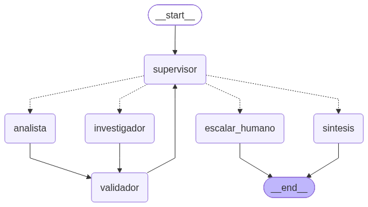
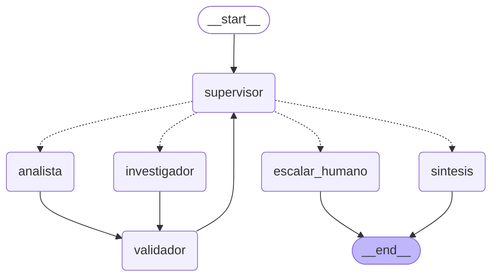

# Pre-entrega 6 — Orquestador Multi-Agente Especializado

Prototipo de un **orquestador multi-agente de Análisis e Investigación** construido con **LangGraph** y
**Gemini**, sobre las políticas internas de *TechCorp* (el RAG híbrido BM25 + Pinecone de las pre-entregas
anteriores).

El sistema resuelve preguntas que requieren **dos dominios de especialización**: *buscar* datos concretos en
documentos y *calcular* con ellos. Termina con una **síntesis final** verificada o, si no puede garantizar un
resultado correcto, **escala a revisión humana**.

> Ejemplo: *"Un empleado va a cumplir 12 años en TechCorp. ¿Cuántos días de vacaciones acumuló en total según
> cada tramo de antigüedad?"* → el Investigador encuentra 14 / 21 / 28 días en `politica_vacaciones.txt`, el
> Analista calcula `5*14 + 5*21 + 2*28 = 231` y el Validador verifica ambos antes de que el Supervisor finalice.

---

## Estructura del repositorio

```
├── state.py                  # Estado compartido (MessagesState) + contratos Pydantic + aislamiento de escritura
├── graph.py                  # StateGraph: nodos, aristas condicionales y compilación
├── validation.py             # Puerta de calidad determinística (validador, sin LLM)
├── main.py                   # CLI de demo: log de auditoría en vivo + logs/*.json + exportar diagrama
├── agents/
│   ├── research_agent.py     # Agente de Búsqueda/Investigación (tool: RAG de políticas)
│   ├── analyst_agent.py      # Agente de Análisis/Cómputo (tool: calculadora segura)
│   ├── supervisor.py         # Supervisor: router con rúbrica, bucle de reparación, guardrails
│   ├── synthesizer.py        # Nodos terminales: síntesis final y escalado a humano
│   ├── prompts.py            # Prompts VERSIONADOS de cada agente
│   └── common.py             # LLM por defecto y utilidades
├── tools/
│   ├── knowledge_base.py     # RAG híbrido BM25 + Pinecone (con degradación a BM25)
│   └── calculator.py         # Evaluador aritmético con `ast` (sin eval)
├── data/                     # Políticas internas de TechCorp (.txt)
├── tests/                    # Tests offline con dobles de prueba (sin API keys)
├── docs/grafo.png, grafo.mmd # Diagrama del grafo (generado con draw_mermaid_png)
└── demo.ipynb                # Notebook que demuestra el flujo de delegación
```

---

## Topología elegida: jerárquica (patrón Supervisor)





*(Las flechas punteadas son las **aristas condicionales** del Supervisor. El diagrama se regenera con
`python main.py --diagrama`.)*

### ¿Por qué jerárquica y no cooperativa?

| Criterio | Por qué conviene la jerarquía en este caso |
|---|---|
| **Flujo con dependencias** | El Analista **no puede** trabajar sin los datos del Investigador. Un orquestador central garantiza ese orden; en una coreografía habría que coordinar eventos entre pares. |
| **Trazabilidad** | Toda decisión pasa por un único punto (el Supervisor), así el log muestra exactamente *quién decidió qué y por qué*. |
| **Seguridad del resultado** | Se reportan números de políticas de RR.HH.: un dato inventado es peor que no responder. La jerarquía permite poner una **puerta de calidad** obligatoria antes de finalizar. |
| **Modularidad** | Sumar un especialista (por ejemplo, uno de análisis de sentimiento) es crear un nodo y agregarlo al `Literal` del Supervisor. |
| **Evita el "caos emergente"** | Sin un jefe, un crítico y un refinador pueden entrar en bucles infinitos. Acá el Supervisor tiene condiciones de parada duras. |

**Riesgo conocido: el Supervisor es un cuello de botella.** Lo mitigamos así: si el LLM del Supervisor falla,
se usa una **política de respaldo determinística** (`politica_de_respaldo`), así el sistema no se paraliza.
Además, los especialistas nunca se hablan entre sí, así que cambiar uno no afecta al resto.

---

## Flujo de una consulta

1. **Supervisor** (paso 1): la rúbrica detecta que faltan datos (R1) y delega en el **Investigador** con una
   instrucción puntual.
2. **Investigador**: usa `buscar_en_politicas_internas` y devuelve un `ResearchArtifact` (hallazgos con valor y fuente).
3. **Validador**: verifica la procedencia (fuente y números presentes en lo que devolvió la búsqueda) y la confianza.
4. **Supervisor**: R1 se cumple pero falta el cálculo (R2), así que delega en el **Analista**.
5. **Analista**: usa `calculadora` y devuelve un `AnalysisArtifact` con la expresión exacta.
6. **Validador**: **recalcula** la expresión y verifica que cada número provenga de un hallazgo o de la pregunta.
7. **Supervisor**: si R1, R2 y R3 se cumplen, responde `FINISH` y pasa a la **Síntesis**, que redacta la
   respuesta y le agrega el cálculo verificado y las fuentes.

Si un paso de validación falla, el Supervisor **pide refinar** al especialista (bucle de reparación). Si el
error persiste, **escala a un humano**.

### Log de auditoría: quién decidió qué y por qué

`python main.py` imprime la bitácora en vivo y la guarda en `logs/ejecucion_<fecha>.json`. Esta es una
**ejecución real con Gemini**. En el primer intento del Analista, la API devolvió un error **503
(modelo saturado)**: el nodo capturó la excepción, el Validador la rechazó y el Supervisor pidió
**refinar**. En el segundo intento el cálculo se aprobó y la tarea terminó con el resultado verificado.

```
🧭 [supervisor    ] paso 1: → investigador
                   ↳ Falla R1: No se dispone de ningún dato validado sobre la política de vacaciones de TechCorp para los diferentes tramos de antigüedad. [prompt supervisor-v1.3] | instrucción: Busca en las políticas internas de TechCorp la cantidad de días de vacaciones anuales que corresponden a un empleado según su antigüedad...
🔎 [investigador  ] intento 1: 3 hallazgo(s)
                   ↳ confianza=1.00; fuentes recuperadas=['politica_horas_extra.txt', 'politica_seguridad_informatica.txt', 'politica_teletrabajo.txt', 'politica_vacaciones.txt']
✅ [validador     ] investigador: APROBADO
🧭 [supervisor    ] paso 2: → analista
                   ↳ Se cumple R1 porque tenemos los datos de las políticas de vacaciones por antigüedad, pero falla R2 ya que no se ha realizado el cálculo del total de días acumulados en los 12 años. [prompt supervisor-v1.3] | instrucción: Calculá el total de días de vacaciones acumulados por el empleado en sus 12 años de antigüedad...
🧮 [analista      ] intento 1: FALLÓ
                   ↳ GoogleAPIError: 503 UNAVAILABLE. {'error': {'code': 503, 'message': 'This model is currently experiencing high demand...', 'status': 'UNAVAILABLE'}}
✅ [validador     ] analista: RECHAZADO
                   ↳ El analista falló con una excepción: GoogleAPIError: 503 UNAVAILABLE...
🧭 [supervisor    ] paso 3: → analista
                   ↳ La salida de analista fue rechazada por el validador; se pide REFINAR (reparación 1/2). [prompt supervisor-v1.3]
🧮 [analista      ] intento 2: 5 * 14.0 + 5 * 21.0 + 2 * 28.0 = 231
                   ↳ confianza=1.00
✅ [validador     ] analista: APROBADO
🧭 [supervisor    ] paso 4: → sintesis
                   ↳ Se cumplen todas las rúbricas de suficiencia: R1 (los datos de las políticas de vacaciones por antigüedad están validados con su fuente), R2 (el analista ya realizó el cálculo correcto del total acumulado de 231 días para los 12 años de antigüedad) y R3 (no faltan datos ni hay contradicciones). [prompt supervisor-v1.3]
📝 [sintesis      ] respuesta final redactada
                   ↳ fuentes=['politica_vacaciones.txt']

RESPUESTA FINAL:
En sus 12 años de antigüedad, el empleado acumuló un total de 231 días de vacaciones. De acuerdo con la
"politica_vacaciones.txt", le correspondieron 14.0 días corridos por año durante los primeros 5 años (menos de
5 años de antigüedad), 21.0 días corridos por año durante los siguientes 5 años (de 5 a 10 años de antigüedad)
y 28.0 días corridos por año en los últimos 2 años (más de 10 años de antigüedad). [...]

Cálculo verificado: 5 * 14.0 + 5 * 21.0 + 2 * 28.0 = 231
Fuentes: politica_vacaciones.txt
```

Otros rechazos del Validador, como un número del Analista sin respaldo (`2*30` cuando la política dice 28)
o un valor alucinado por el Investigador, están cubiertos por los tests de `tests/test_orquestador.py`.

---

## Agentes especializados y herramientas

| Agente | Construcción | Herramienta (acotada) | Salida estructurada | Qué NO puede hacer |
|---|---|---|---|---|
| **Investigador** | `create_agent` + `ToolStrategy` | `buscar_en_politicas_internas`: RAG híbrido BM25 + Pinecone | `ResearchFindings` → `ResearchArtifact` | Calcular o sacar conclusiones |
| **Analista** | `create_agent` + `ToolStrategy` | `calculadora`: evaluador `ast`, sin `eval` | `AnalysisResult` → `AnalysisArtifact` | Buscar o inventar datos |
| **Supervisor** | `llm.with_structured_output(DecisionSupervisor)` | — (coordina, no ejecuta) | `DecisionSupervisor{next, razon, instruccion}` | Hacer el trabajo de los especialistas |
| **Validador** | Python puro (determinístico) | `evaluar_expresion` (recalcula) | `ValidationReport` | Opinar: solo aplica reglas |
| **Síntesis** | LLM + pie determinístico | — | Texto + cálculo verificado + fuentes | Usar datos no aprobados |

**Contexto acotado (evita la contaminación de contexto).** Ningún especialista recibe el historial completo:

- El **Investigador** recibe solo la `instruccion` del Supervisor y, si está reparando, el feedback de reparación.
- El **Analista** recibe la pregunta, la instrucción y **solo los hallazgos validados**.
- El **Supervisor** recibe un **resumen del estado** (artefactos aprobados y el número de paso), no la conversación.

El test `test_contexto_acotado_el_especialista_no_recibe_el_historial` lo verifica.

---

## Estado compartido estructurado (`state.py`)

`AgentState` hereda de `MessagesState` y agrega campos **organizados por dueño**:

| Parcela | Dueño (único que puede escribirla) | Campos |
|---|---|---|
| Control de flujo | `supervisor` | `next_agent`, `instruccion`, `feedback_reparacion`, `pasos`, `task_completed` |
| Investigación | `investigador` | `research_output: ResearchArtifact`, `intentos_investigador` |
| Análisis | `analista` | `analysis_output: AnalysisArtifact`, `intentos_analista` |
| Calidad | `validador` | `validaciones: list[ValidationReport]` (append-only) |
| Resultado | `sintesis` / `escalar_humano` | `respuesta_final`, `escalado_humano` |
| Compartidos append-only | todos | `messages`, `contribuciones`, `bitacora` (reducer `operator.add`) |

Tres mecanismos del estado:

- **Aislamiento de escritura.** `graph.py` envuelve cada nodo con `verificar_escritura()`. Si un nodo intenta
  escribir fuera de su parcela, se lanza `ViolacionDeEscritura`. Así ningún agente puede pisar lo que calculó otro.
- **Estado como contrato.** Los datos entre agentes son modelos Pydantic: `confidence_score` tiene que estar entre 0 y 1
  (`Field(ge=0, le=1)`), `hallazgos` no puede estar vacío y `expresion` solo admite caracteres aritméticos
  (`field_validator`). Si el LLM alucina el formato, `ToolStrategy` le devuelve el error de validación para que lo corrija.
- **Sin pérdida de contexto.** `contribuciones` y `bitacora` usan `operator.add`: cada nodo **suma** su aporte y
  su decisión, nunca los sobrescribe.

---

## Validación y manejo de conflictos entre agentes

### Validación determinística ("Pydantic, no vibras")
El nodo `validador` corre **después de cada especialista** y no usa un LLM:

| Sobre el Investigador | Sobre el Analista |
|---|---|
| Usó la herramienta (hay fuentes recuperadas) | La expresión es aritmética válida |
| Cada `fuente` citada fue **realmente devuelta** por la búsqueda | **Recalcula** la expresión y la compara con el `resultado` declarado |
| Cada `valor` numérico **aparece en el texto recuperado** (anti-alucinación) | Cada número de la expresión **proviene de un hallazgo validado o de la pregunta** |
| `confidence_score ≥ 0.5` | Solo analiza si la investigación está aprobada; `confidence_score ≥ 0.5` |

### Conflictos: se resuelven por procedencia, no por promedio ni por mayoría
Si el Analista "contradice" al Investigador (por ejemplo, usa 30 días cuando la política dice 28), no se promedia
ni se vota, porque dos agentes con el mismo modelo base pueden alucinar lo mismo. **Gana el dato que tiene
procedencia verificable**: el número tiene que rastrearse hasta un hallazgo aprobado, y el hallazgo hasta el
texto que devolvió la búsqueda. El dato sin respaldo se rechaza y se le pide al agente que lo corrija.

### Bucle de reparación: error específico, no un reintento a ciegas
Cuando una validación falla, el Supervisor **no** repite "intentá de nuevo". Le reenvía al mismo especialista
**su salida anterior junto con los errores concretos** del validador (`prompt_de_reparacion`), por ejemplo:

```
⚠️ TU RESPUESTA ANTERIOR NO PASÓ LA VALIDACIÓN AUTOMÁTICA.
Tu salida anterior fue: { "expresion": "5*14 + 5*21 + 2*30", "resultado": 235.0, ... }
Errores específicos detectados:
- Los números ['30'] de la expresión no provienen de ningún hallazgo validado ni de la pregunta.
Corregí SOLO esos puntos y devolvé la salida completa nuevamente.
```

### Cuándo se escala a revisión humana (human-in-the-loop)
- Un especialista falló la validación **más de `MAX_REINTENTOS` = 2 veces** (el error se considera irresoluble), o
- se alcanzó `MAX_PASOS` **sin ningún dato validado**.

El nodo `escalar_humano` genera un ticket con el motivo y los intentos, y **no entrega una respuesta
automática**. En producción se usaría `langgraph.types.interrupt()` con un checkpointer para pausar el grafo
hasta que una persona lo revise.

### El Supervisor decide si la tarea está completa o hay que refinar
Decide en tres capas, de la más determinística a la menos:
1. **Parada dura**: `pasos > MAX_PASOS (8)` corta el ciclo (así se evita el "Supervisor infinito").
2. **Reparación**: si la última validación falló, pide refinar o escala a humano.
3. **LLM con rúbrica de suficiencia** (R1 datos con fuente, R2 cálculo que responde la pregunta, R3 sin
   faltantes ni contradicciones). Encima hay **guardrails**: no puede responder `FINISH` sin datos validados ni
   mandar al Analista sin investigación aprobada (en esos casos lo corrige con un `OVERRIDE`, que queda en el log).

Los prompts están **versionados** (`agents/prompts.py`) y cada decisión registra la versión usada.

---

## Cómo ejecutarlo

```bash
python -m venv .venv
.venv\Scripts\activate          # Windows  (Linux/Mac: source .venv/bin/activate)
pip install -r requirements.txt
copy .env.example .env          # completar GOOGLE_API_KEY (y opcionalmente PINECONE_API_KEY)

python main.py                               # escenario vacaciones (Investigador → Analista → FINISH)
python main.py --escenario horas_extra       # porcentajes: puede disparar el bucle de reparación
python main.py --escenario capacitacion
python main.py --pregunta "¿Cuántos días presenciales hay en 4 semanas de teletrabajo estándar?"
python main.py --simular-fallo investigador  # camino de fallo → reparaciones → escalado humano
python main.py --diagrama                    # regenera docs/grafo.png y docs/grafo.mmd
```

Sin `PINECONE_API_KEY`, el Investigador **degrada a BM25 local** (y lo deja en el log), así el sistema se puede
correr solo con la clave de Gemini.

### Tests (no requieren API keys)
```bash
python -m pytest -v
```
Cubren: el camino feliz, el contexto acotado, la reparación del Analista, los números sin procedencia, un valor
alucinado por el Investigador, un especialista que lanza una excepción (escala a humano), el LLM del Supervisor
caído (política de respaldo), `MAX_PASOS`, el guardrail de `FINISH`, el aislamiento de escritura, el rango de
`confidence_score` y la calculadora ante código malicioso.

### Demo
[`demo.ipynb`](demo.ipynb) corre los tres escenarios y el camino de fallo, y muestra el grafo, las
contribuciones, las validaciones y los artefactos Pydantic de cada agente.
